# Bug Fix Porting — Git-First Backporting with LLM Fallback

Port a bug fix from one branch to another using Claude as the AI engine. The pipeline tries `git cherry-pick` first, resolves conflicts with an LLM, and falls back to a full LLM-powered autonomous build-test-fix loop when needed.

**Location**: `auto_bug_fix/`
**Entry point**: `python -m auto_bug_fix.run_bug_fix <config.yaml>`

## Prerequisites

- Python 3.10+
- [Claude Agent Python SDK](https://pypi.org/project/claude-agent-sdk/) (`pip install claude-agent-sdk`)
- A cloned git repository with both the source branch (has the fix) and target branch (needs the fix)
- Shell-invokable build and test commands for the project

## Quick Start

### 1. Create a YAML config

```yaml
issue_id: "crio-post-stop-hooks-9613-to-1.33"

bug_description: "Fix race condition in post-stop hook ordering..."

repository:
  source_path: "/path/to/cri-o"
  workdir: "/tmp/bugfix-workdir"

branches:
  source: "origin/main"
  target: "b9ac8350f"  # commit or branch name

fix:
  commit: "92c18a2e2673764cd10f89b1a5061e2b26f44209"

build:
  command: "go build $(go list ./... | grep -v /test)"
  test_command: "go vet $(go list ./... | grep -v /test)"

model: "claude-sonnet-4-6"
```

Config files should be placed in `auto_bug_fix/configs/` and are gitignored.

### 2. Run

```bash
python -m auto_bug_fix.run_bug_fix auto_bug_fix/configs/your_config.yaml
```

Output is written to `runs/<issue_id>_<timestamp>/`.

## How It Works

The pipeline takes a **git-first** approach: try `git cherry-pick` first, resolve conflicts with an LLM, and only fall back to the full LLM pipeline when that fails. This is faster and cheaper for commits that cherry-pick cleanly or with minor conflicts, which empirically covers ~70% of backports.

When the pipeline's own conflict resolution and build-error recovery can't fix remaining failures, it escalates to `auto_code_gen`'s `RunAndFixPrompt` — an autonomous build-test-fix loop powered by Opus with deep thinking — passing ALL accumulated context (dossier, triage, prerequisite analysis) so the LLM has the full picture.

## Pipeline Phases

| Phase | Name | Description |
|-------|------|-------------|
| **0** | **Deterministic Triage** | Derives seed files from the fix commit, checks whether the fix is already present on the target branch (forward patch-ID), whether the target branch is affected (backward patch-ID + ancestry), and resolves any file renames between branches. Stops early if the fix is a duplicate or the target is not affected. |
| **0.5** | **Semantic Triage** | An LLM analyzes the fix commit to classify difficulty, identify prerequisite commits (and whether each is portable or call-convention-only), discover generated files and their regeneration commands, find lint/verification commands, flag files to skip, and rank priority files. Writes `semantic_triage.json`. |
| **0.5b** | **Prerequisite Porting** | Cherry-picks prerequisite commits that the fix depends on for actual behavior (`portable: true`). Prerequisites that only change calling conventions (`portable: false`) are skipped — the resolution agent adapts the call site to match the target branch's existing API instead. Max depth of 5. |
| **0.5c** | **Test Porting** | An LLM ports test files from the fix commit to the target branch's test infrastructure, filtered by `files_to_skip`. Ensures the ported tests exist before the baseline phase so the RED check can detect if the bug is already fixed. |
| **1** | **Comprehensive Baseline** | Runs the build command, test command, and all lint/verification commands discovered by Phase 0.5 on the **clean target branch** before any changes. Records all results as the baseline. Also performs a RED check — if the ported tests already pass, the bug is already fixed and the pipeline stops. |
| **1.5** | **Failure-Mode Confirmation** | Compares failure signatures to confirm the target branch exhibits the expected bug behavior. Cleans the worktree (`git reset --hard HEAD`) in preparation for the cherry-pick. |
| **2+3a** | **Cherry-Pick + Conflict Resolution** | Attempts `git cherry-pick` using three merge strategies (default, patience, ort) and picks the one with fewest conflicts. Reverts `files_to_skip` to the target branch version (both conflicting and cleanly-applied). An LLM resolution agent resolves any remaining source conflicts. If the agent can't resolve after retries, conflicts are force-resolved with `--theirs` and the broken state is committed for Phase 4b. |
| **3b** | **Regeneration** | Runs project-specific code generation commands (e.g., `go generate`, `make proto`) discovered by Phase 0.5 to regenerate auto-generated files. Saves a safe point first and rolls back on failure. |
| **4** | **Verify** | Runs the build and test commands from the YAML config. Checks for regressions against the Phase 1 baseline. |
| **4a** | **Build Error Recovery** | When Phase 4 fails, an LLM diagnoses compiler/linker/test errors, edits source files to fix them, and re-runs verification — up to `max_resolution_retries` attempts. |
| **4.1** | **Extended Verification** | Runs all additional lint and verification commands discovered by Phase 0.5. Filters results against the Phase 1 baseline — pre-existing failures are logged and skipped, only NEW failures introduced by the backport trigger escalation to Phase 4a/4b. |
| **4b** | **auto_code_gen Escalation** | Last-resort handoff to the [auto_code_gen pipeline](auto_code_gen/README.md). Bundles the full dossier, semantic triage, and repo config into an enriched context, then launches an Opus agent (deep thinking, max effort) running an autonomous build-test-fix loop (`RunAndFixPrompt`). The agent has full shell access and iterates up to `max_build_test_retries` times. Writes `run_and_fix_success.txt` or `run_and_fix_failure.txt`. See [Phase 4b details](#phase-4b--auto_code_gen-escalation) below. |
| **4.5** | **Semantic Equivalence** | Runs `git range-diff` comparing the upstream fix to the backported commits. Classifies each commit as identical, modified, or unmatched — recorded in the dossier for review. |

---

## Detailed Flowchart

```mermaid
flowchart TD
    CONFIG[YAML Config File] --> WORKTREE[Create Git Worktree on target branch]

    WORKTREE --> P0{{"PHASE 0 — TRIAGE"}}
    P0 --> SEED[Derive seed files from fix commit]
    SEED --> FWD{Forward patch-ID check}
    FWD -->|found| STOP_DUP([STOP — duplicate])
    FWD -->|not found| BWD{Backward patch-ID + ancestry}
    BWD -->|affected| RENAME[Resolve renames + build allowlist]
    BWD -->|not affected| SEED_EXISTS{Seed files exist on target?}
    SEED_EXISTS -->|yes| RENAME
    SEED_EXISTS -->|no| STOP_NA([STOP — not affected])

    RENAME --> P05{{"PHASE 0.5 — SEMANTIC TRIAGE (LLM)"}}
    P05 --> TRIAGE_OUT["LLM analyzes fix commit:\n• commit type, difficulty\n• prerequisites (portable vs call-convention)\n• files_to_skip\n• lint + verification commands\n• priority files\n→ writes semantic_triage.json"]

    TRIAGE_OUT --> PREREQ{Portable prerequisites?}
    PREREQ -->|yes| P05B{{"PHASE 0.5b — PREREQ CHAIN"}}
    P05B --> PREREQ_CP["Cherry-pick each portable prerequisite\n(max 5 depth)\n\nportable=false → adapt at call site"]
    PREREQ_CP --> TEST_CHECK
    PREREQ -->|no| TEST_CHECK

    TEST_CHECK{Test files in commit?\nfiltered by files_to_skip} -->|yes| P05C{{"PHASE 0.5c — TEST PORT (LLM)"}}
    P05C --> TEST_PORT[LLM ports test files to target branch]
    TEST_PORT --> P1
    TEST_CHECK -->|no| P1

    P1{{"PHASE 1 — COMPREHENSIVE BASELINE"}}
    P1 --> BASELINE["1. Run build command\n2. Run test command\n3. Run ALL lint + verification commands\n\nStore baseline_build_exit,\nbaseline failures, baseline_verification\nRecord in dossier"]
    BASELINE --> RED{RED check\nbugfix + ported tests?}
    RED -->|tests pass| STOP_FIXED([STOP — already fixed])
    RED -->|tests fail or N/A| P15

    P15{{"PHASE 1.5 — FAILURE-MODE CONFIRMATION"}}
    P15 --> CLEANUP[Pre-cherry-pick cleanup\ngit reset --hard HEAD]

    CLEANUP --> P23{{"PHASE 2+3a — CHERRY-PICK + RESOLVE"}}
    P23 --> STRAT["Try 3 strategies:\ndefault / patience / ort\nPick fewest conflicts"]
    STRAT --> CP_RESULT{Cherry-pick result}
    CP_RESULT -->|clean| COMMIT_CLEAN[Commit]
    CP_RESULT -->|conflicts| SKIP_FILES["files_to_skip processing:\n1. Revert cleanly-applied skip files\n2. Auto-resolve conflicting skip files --theirs"]

    SKIP_FILES --> REMAIN{Source conflicts remain?}
    REMAIN -->|no| COMMIT_SKIP[Commit]
    REMAIN -->|yes| LLM_RESOLVE["LLM Resolution Agent\n(NarrowResolutionAgentPrompt)"]
    LLM_RESOLVE --> RESOLVE_RESULT{Resolved?}
    RESOLVE_RESULT -->|yes| COMMIT_RESOLVED[Commit with summary]
    RESOLVE_RESULT -->|no| RETRY{Retry < max?}
    RETRY -->|yes| LLM_RESOLVE
    RETRY -->|no| ESCALATE_CP["Force-resolve --theirs\nCommit broken state"]
    ESCALATE_CP --> P4B

    COMMIT_CLEAN --> REGEN_CHECK
    COMMIT_SKIP --> REGEN_CHECK
    COMMIT_RESOLVED --> REGEN_CHECK

    REGEN_CHECK{Regen commands + skipped files?}
    REGEN_CHECK -->|yes| P3B{{"PHASE 3b — REGENERATION"}}
    P3B --> REGEN["Save safe point\nRun codegen commands\nRollback on failure"]
    REGEN --> P4
    REGEN_CHECK -->|no| P4

    P4{{"PHASE 4 — VERIFY"}}
    P4 --> VERIFY["Run build_command\nRun test_command\nCheck regression vs baseline"]
    VERIFY --> V_RESULT{Pass?}
    V_RESULT -->|yes| P41_CHECK
    V_RESULT -->|no| P4A

    P4A{{"PHASE 4a — BUILD ERROR RECOVERY (LLM)"}}
    P4A --> RECOVERY["LLM diagnoses errors\nEdits source files\n(up to max_retries)"]
    RECOVERY --> REC_RESULT{Fixed?}
    REC_RESULT -->|yes| P4_REVERIFY["Re-run Phase 4 verify"]
    P4_REVERIFY --> P41_CHECK
    REC_RESULT -->|no| P4B

    P41_CHECK{Verification commands from triage?}
    P41_CHECK -->|no| P45
    P41_CHECK -->|yes| P41

    P41{{"PHASE 4.1 — EXTENDED VERIFICATION"}}
    P41 --> EXT_VERIFY["Run each lint/verification command\n\n• Failed in baseline → pre-existing, SKIP\n• NEW failure → escalate"]
    EXT_VERIFY --> EXT_RESULT{New failures?}
    EXT_RESULT -->|none| P45
    EXT_RESULT -->|yes| P4A_EXT["Phase 4a recovery"]
    P4A_EXT --> P4A_EXT_RESULT{Fixed?}
    P4A_EXT_RESULT -->|yes| P41_RERUN["Re-run extended verify"]
    P41_RERUN --> P45
    P4A_EXT_RESULT -->|no| P4B

    P4B{{"PHASE 4b — EXTERNAL PIPELINE (Opus)"}}

    P4B --> P4B_CTX["Build enriched context:\n• Full pipeline dossier\n• Semantic triage JSON\n• Repo config + commands"]
    P4B_CTX --> P4B_JSON["Write phase_4b_input.json\nto run directory\n(output_dir, config, dossier, triage)"]
    P4B_JSON --> P4B_CFG["Configure Opus agent:\n• model: claude-opus-4-6\n• thinking: adaptive\n• effort: max\n• max_thinking_tokens: 1M"]
    P4B_CFG --> P4B_PROMPT["Generate RunAndFixPrompt\nfrom auto_code_gen\n(build cmd, test cmd, max retries)"]
    P4B_PROMPT --> P4B_TEE["Redirect stdout → phase_4b_log.txt\n(tee: terminal + file)"]
    P4B_TEE --> P4B_SDK["Single SDK call: claude_run\nOpus gets full shell access to repo"]

    P4B_SDK --> P4B_LOOP["Autonomous build-test-fix loop:\n1. Run build_command\n2. Build fails → inspect errors, fix code, retry\n3. Build passes → run test_command\n4. Tests fail → inspect output, fix code, rebuild\n5. Repeat until clean or retries exhausted"]

    P4B_LOOP --> P4B_WRITE{Agent writes sentinel file}
    P4B_WRITE -->|"run_and_fix_success.txt\n(SUCCESS + retries + fixes)"| P4B_OK
    P4B_WRITE -->|"run_and_fix_failure.txt\n(errors + attempted fixes)"| P4B_FAIL

    P4B_OK["Update phase_4b_input.json:\n• outcome: success\n• duration_seconds\n• input/output tokens\n• result_summary\n\nCopy success file to run dir"]
    P4B_OK --> P4B_RESTORE["Restore stdout\nRecord in dossier + tracker"]
    P4B_RESTORE --> P45

    P4B_FAIL["Update phase_4b_input.json:\n• outcome: failure\n• result_summary\n\nCopy failure file to run dir"]
    P4B_FAIL --> P4B_ESC([PIPELINE FAILED — PipelineEscalation])

    P45{{"PHASE 4.5 — SEMANTIC EQUIVALENCE"}}
    P45 --> RANGEDIFF["git range-diff\nupstream vs backport\n→ identical / modified / unmatched"]

    RANGEDIFF --> OUTPUT["PHASE 5 — OUTPUTS\n\n• dossier.md\n• tracker.json\n• run_log.txt\n• semantic_triage.json\n• phase_4b_input.json\n• phase_4b_log.txt\n• commit trailers"]

    style P0 fill:#4a90d9,color:#fff
    style P05 fill:#4a90d9,color:#fff
    style P05B fill:#4a90d9,color:#fff
    style P05C fill:#4a90d9,color:#fff
    style P1 fill:#4a90d9,color:#fff
    style P15 fill:#4a90d9,color:#fff
    style P23 fill:#4a90d9,color:#fff
    style P3B fill:#4a90d9,color:#fff
    style P4 fill:#4a90d9,color:#fff
    style P4A fill:#e8a838,color:#fff
    style P41 fill:#4a90d9,color:#fff
    style P4B fill:#d94a4a,color:#fff
    style P4B_LOOP fill:#d94a4a,color:#fff
    style P4B_SDK fill:#d94a4a,color:#fff
    style P45 fill:#4a90d9,color:#fff
    style STOP_DUP fill:#888,color:#fff
    style STOP_NA fill:#888,color:#fff
    style STOP_FIXED fill:#888,color:#fff
    style P4B_ESC fill:#d94a4a,color:#fff
    style OUTPUT fill:#2d8659,color:#fff
```



---

## Phase 4b — auto_code_gen Escalation

Phase 4b is the last-resort escalation. It fires when the gitted pipeline's own recovery mechanisms (Phase 4a) cannot fix build or test failures. Instead of giving up, it hands the broken worktree to a more powerful LLM (Opus with deep thinking) running an autonomous build-test-fix loop.

### When it triggers

Phase 4b fires in three scenarios:

1. **Cherry-pick resolution crashes** — the Sonnet agent fails to resolve all conflicts. The pipeline force-resolves remaining conflicts with `--theirs` (keeps target version), commits the broken state, then hands off to 4b.
2. **Phase 4a exhausts retries** — the build error recovery agent couldn't fix compile/test errors within `max_resolution_retries` iterations.
3. **Phase 4.1 extended verification fails** — lint or additional test commands produce NEW failures (not pre-existing) that Phase 4a can't fix.

### What gets passed to the Opus agent

The pipeline builds an **enriched context** that bundles everything it has learned:

```xml
<context>
  <output_dir>/tmp/bugfix-workdir/issue-id</output_dir>
  <repo_path>/tmp/bugfix-workdir/issue-id</repo_path>
  <build_dir>/tmp/bugfix-workdir/issue-id/.</build_dir>
  <source_branch>origin/main</source_branch>
  <target_branch>b9ac8350f</target_branch>
  <source_fix_commit>92c18a2e26...</source_fix_commit>
  <bug_description>...</bug_description>
  <build_command>go build ...</build_command>
  <test_command>go vet ...</test_command>
  <max_build_test_retries>3</max_build_test_retries>
</context>

<pipeline_dossier>
  Full audit trail from all prior phases:
  - Phase 0 triage gates
  - Phase 0.5 semantic triage assessment
  - Cherry-pick conflict resolution details
  - Build/test errors encountered
  - Phase 4a recovery attempts
</pipeline_dossier>

<semantic_triage>
  The Phase 0.5 JSON assessment:
  - Difficulty classification
  - Priority files
  - Prerequisites and their portability
  - Lint/verification commands
  - Files to skip
</semantic_triage>
```

### How the Opus agent runs

1. Creates an **Opus ClaudeConfig** with deep thinking enabled:
   - Model: `claude-opus-4-6`
   - Thinking: `{"type": "adaptive"}`
   - Effort: `max`
   - Max thinking tokens: 1,048,576 (1M)

2. Generates a `RunAndFixPrompt` from `auto_code_gen.use_cases.bug_fix` — a self-contained autonomous loop prompt:

```python
from auto_code_gen.use_cases.bug_fix import gen_RunAndFixPrompt

prompt = gen_RunAndFixPrompt(
    context=enriched_context,
    build_command=config.build_command,
    test_command=config.test_command,
    build_dir=config.build_dir,
    max_build_test_retries=config.max_build_test_retries,
)
```

3. Runs it as a **single SDK call** via `claude_run` — one Opus conversation that gets full shell access to the repo.

### What the Opus agent does autonomously

The agent runs a **build-test-fix loop**:

```
1. Run build_command from build_dir
2. If build fails:
   ├─ Inspect compiler/linker output
   ├─ Apply targeted fix to source code
   └─ Retry build (incremental, no clean rebuild)
3. If build passes → run test_command
4. If tests fail:
   ├─ Inspect test output
   ├─ Identify root cause (fix code or ported tests)
   ├─ Apply targeted fix
   ├─ Recompile (incremental)
   └─ Rerun tests
5. Count each build+test attempt as one retry
6. Repeat until clean or max_build_test_retries exhausted
```

The agent has the full dossier context so it knows:
- What the triage found (API divergences, files to skip, prerequisites)
- What the resolution agent already tried
- Which errors are pre-existing vs introduced by the backport

### How we know if it succeeded

The agent writes one of two sentinel files:
- **`run_and_fix_success.txt`** — first line is "SUCCESS", includes retry count, fixes applied, and full test output
- **`run_and_fix_failure.txt`** — failure log with all attempted fixes and final errors

After the SDK call returns, Phase 4b checks for the failure file. If it exists → `PipelineEscalation` (pipeline fails). If not → success, pipeline continues to Phase 4.5.

### Logging and artifacts

**Before the run**:
- `phase_4b_input.json` is written to the run directory with the full input context (config, dossier, semantic triage)

**During the run**:
- stdout is tee'd to `phase_4b_log.txt` in the run directory — captures the complete Opus conversation including all tool calls, thinking blocks, and results

**After the run**:
- `phase_4b_input.json` is updated with post-run results:
  - `outcome`: "success" or "failure"
  - `duration_seconds`: wall-clock time
  - `input_tokens` / `output_tokens`: token counts
  - `result_summary`: full content of the success/failure file
- `run_and_fix_success.txt` or `run_and_fix_failure.txt` is copied from the worktree to the run directory

### Example phase_4b_input.json (after completion)

```json
{
  "output_dir": "runs/crio_1.34_backport_20260615_171314",
  "repo_path": "/tmp/bugfix-workdir/crio-post-stop-hooks-9613-to-1.34",
  "build_dir": "/tmp/bugfix-workdir/crio-post-stop-hooks-9613-to-1.34/.",
  "source_branch": "origin/main",
  "target_branch": "cc8e8609e",
  "source_fix_commit": "92c18a2e2673764cd10f89b1a5061e2b26f44209",
  "issue_id": "crio-post-stop-hooks-9613-to-1.34",
  "build_command": "go build $(go list ./... | grep -v /test | grep -v nsmgr/test)",
  "test_command": "go vet $(go list ./... | grep -v /test | grep -v nsmgr/test)",
  "max_build_test_retries": 3,
  "model": "claude-opus-4-6",
  "dossier": "# Bug-Fix Porting Dossier: ...",
  "semantic_triage": { "..." : "..." },
  "duration_seconds": 192.0,
  "input_tokens": 319,
  "output_tokens": 7847,
  "outcome": "success",
  "result_summary": "SUCCESS\nRetries: 0/3\n\nBuild: PASSED ..."
}
```

---

## Key Design Decisions

### Prerequisite portability

The triage prompt distinguishes between two kinds of prerequisites:

- **`portable: true`** — The fix depends on the prerequisite's actual behavior (e.g., a new type the fix stores data in). These are cherry-picked before the main fix.
- **`portable: false`** — The prerequisite only changes a calling convention (extra parameter, renamed function, moved package). The resolution agent adapts the call site to match the target branch's existing API instead of porting the entire refactor.

This prevents porting unnecessary refactors that bloat the diff without adding fix-relevant behavior.

### Comprehensive baseline (Phase 1)

Phase 1 runs build, test, and all lint/verification commands on the **clean target branch** before any changes. This baseline data is used by Phase 4.1 to distinguish regressions from pre-existing failures:

- If a verification command already failed on the clean branch → logged as "pre-existing" and skipped
- Only NEW failures introduced by the backport trigger Phase 4a/4b escalation

This eliminates false Phase 4b escalations for issues like missing lint tools or `//go:build test`-gated test failures.

### files_to_skip handling

Files identified by the triage as irrelevant (e.g., lint changes depending on unported refactors) are:
1. **Excluded from test port** (Phase 0.5c) — won't be ported as test files
2. **Reverted after cherry-pick** (Phase 2+3a) — both conflicting AND cleanly-applied skip files are reset to the target branch version

---

## Example Run — CRI-O Post-Stop Hooks to release-1.34

Backport of [PR #9613](https://github.com/cri-o/cri-o/pull/9613) to `release-1.34`, compared against human backport [PR #9699](https://github.com/cri-o/cri-o/pull/9699).

| Phase | Duration | Detail |
|-------|----------|--------|
| Phase 0 — Triage | 3s | 9 seed files, not already on target |
| Phase 0.5 — Semantic triage | 5 min | MEDIUM difficulty, 3 prerequisites (all `portable: false`), 2 files to skip |
| Phase 0.5c — Test port | 10 min | 2 test files ported |
| Phase 1 — Baseline | 10s | Build PASSED, `go vet` PASSED, `go test ./server/...` FAILED (pre-existing) |
| Phase 2+3a — Cherry-pick + resolve | 5 min | 2 conflicts resolved by Sonnet, skip files reverted to target |
| Phase 4 — Verify | 4s | Build + test PASSED |
| Phase 4.1 — Extended verification | 2s | `golangci-lint` failed → **pre-existing** (not installed), skipped |
| Phase 4b — External pipeline | 3 min | Opus confirmed all failures are pre-existing, no code changes needed |
| Phase 4.5 — Semantic equivalence | 0s | `unmatched` (expected — API adaptations) |

**Result**: All 7 production files byte-for-byte identical to human backport PR #9699. Phase 4b was triggered by `golangci-lint` not being installed — an environmental issue, not a code problem. The Opus agent verified build and `go vet` pass cleanly and wrote `run_and_fix_success.txt`.

---

## Config Examples

### gcc CVE

```json
{
    "use_case": "bug_fix",
    "repo_path": "/home/user/gcc",
    "build_dir": "/home/user/gcc/build",
    "source_branch": "gcc-14-branch",
    "target_branch": "gcc-13-branch",
    "source_fix_commit": "abc1234",
    "bug_description": "CVE-2024-XXXX: buffer overflow in fold_convert()",
    "issue_id": "CVE-2024-XXXX",
    "output_dir": "/tmp/gcc_cve_output",
    "build_command": "make -j$(nproc)",
    "test_command": "make check RUNTESTFLAGS='gcc.dg/CVE-2024-XXXX.c' -j$(nproc)",
    "disallowed_modules": ["gcc/config/arm/"],
    "max_build_test_retries": 3
}
```

### openssl CVE

```json
{
    "use_case": "bug_fix",
    "repo_path": "/home/user/openssl",
    "source_branch": "openssl-3.2",
    "target_branch": "openssl-3.1",
    "source_fix_commit": "def5678",
    "bug_description": "CVE-2024-YYYY: use-after-free in SSL_free()",
    "issue_id": "CVE-2024-YYYY",
    "output_dir": "/tmp/openssl_fix",
    "build_command": "make -j$(nproc)",
    "test_command": "make test TESTS=test_ssl_old -j$(nproc)",
    "disallowed_modules": ["apps/", "doc/"]
}
```

### curl (cmake, macOS)

```json
{
    "use_case": "bug_fix",
    "repo_path": "/path/to/curl",
    "build_dir": "/path/to/curl/build",
    "source_branch": "curl-8_19_0",
    "target_branch": "curl-8_18_0",
    "source_fix_commit": "b35e58b24c",
    "bug_description": "openssl: fix potential OOB read in debug/verbose logging",
    "issue_id": "20656",
    "output_dir": "/tmp/curl_fix",
    "build_command": "cmake --build /path/to/curl/build -j$(sysctl -n hw.logicalcpu)",
    "test_command": "ctest --test-dir /path/to/curl/build -j$(sysctl -n hw.logicalcpu)",
    "disallowed_modules": [],
    "code_port_plan_skip_review": true,
    "code_gen_skip_review": true
}
```

### Build Command Guidelines

- Always use incremental compilation. Claude never does a speculative clean rebuild.
- Use `-j$(nproc)` on Linux, `-j$(sysctl -n hw.logicalcpu)` on macOS.
- For cmake projects, configure the build directory once before running (`cmake ..`).
- Scope `test_command` to the relevant test file/suite when possible to reduce cycle time.

---

## Output Files

All output is written to `runs/<issue_id>_<timestamp>/`:

| File | Description |
|------|-------------|
| `run_log.txt` | Full pipeline log |
| `dossier.md` | Full audit trail |
| `semantic_triage.json` | Phase 0.5 assessment |
| `<issue_id>_<timestamp>.json` | Machine-readable run metrics |
| `phase_4b_input.json` | Phase 4b context (if triggered) |
| `phase_4b_log.txt` | Phase 4b conversation (if triggered) |
| `run_and_fix_success.txt` / `run_and_fix_failure.txt` | Phase 4b result (if triggered) |
| `pipeline.diff` / `human_backport_*.diff` | Comparison diffs (if generated) |

---

## On Failure

If the runtime phase exhausts its retries, it writes a failure log (`run_and_fix_failure.txt`) and exits.

Manual escalation:

```bash
# Deeper investigation of a specific issue
python -m auto_code_gen.run_investigate_issue --config <config.json> ...

# Direct fix attempt
python -m auto_code_gen.run_fix_issue --config <config.json> ...
```

Or increase `max_build_test_retries` and re-run.
