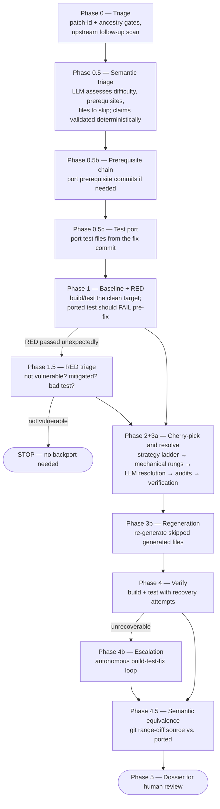

# Auto Bug Fix — git-first backport pipeline

Automatically backports a bug fix commit from one branch to another (e.g. upstream `main` → a release or distribution branch), producing a reviewable commit, a patch file, and a human-readable dossier of everything it did and why.

The design is **git-first**: the pipeline exhausts deterministic, byte-exact mechanisms before letting an LLM touch anything, and every LLM edit is audited against deterministic evidence afterwards.

```
cherry-pick (3-way merge, several strategies)
  └─ conflicts? → mechanical re-apply (git apply, relaxed context)
        └─ still conflicted? → LLM conflict resolution (narrow, per-file)
              └─ always → deterministic audits + verification agent
```

The guiding rule for resolution is three-way discipline: lines the fix changes carry the fix's exact bytes, lines the fix doesn't touch carry the target's exact bytes, and adaptations are only allowed with hard evidence from the target tree (missing symbols, changed signatures, dead config). Human backports overwhelmingly follow this rule; the machinery exists to hold the LLM to it.

---

## How it works



### Phase summary

| Phase | What it does |
|---|---|
| 0 — Triage | Deterministic gates: is the fix already on the target (patch-id, ancestry)? Scans the source branch for upstream follow-up fixes (`Fixes:` tags) to the commit being ported. |
| 0.5 — Semantic triage | An agent assesses difficulty, prerequisite commits, files to skip (e.g. generated files), and regeneration commands. Its prerequisite claims are then validated deterministically against the target tree (0.5.1) and corrected if wrong. |
| 0.5b — Prerequisite chain | Ports prerequisite commits first when the triage found portable ones. |
| 0.5c — Test port | If the fix commit contains test files, ports them before the fix so RED/GREEN checking is possible. |
| 1 — Baseline + RED | Builds and tests the clean target branch to record pre-existing failures. The ported test is expected to FAIL (RED) before the fix is applied. |
| 1.5 — RED triage | If RED unexpectedly passed: decides between *not vulnerable* (pipeline stops — no backport needed), *mitigated* (port anyway for defense-in-depth), or *bad test* (produce a replacement or escalate). |
| 2+3a — Cherry-pick and resolve | `git cherry-pick` with a strategy ladder (default → patience → ort). Conflicted files first go through mechanical rungs (`git apply --ignore-whitespace`, `-C1` of the per-file patch onto the target side — byte-spliced, never regenerated). What remains goes to a narrowly-scoped LLM resolution loop. Finalization then runs the deterministic safety nets (below) and two review agents (3a.1 verification fed with computed evidence, 3a.2 triage-blind review). |
| 3b — Regeneration | Runs the validated regeneration commands for generated files that were deliberately skipped, keeping the result only if the build still passes. |
| 4 — Verify | Build + test. On failure, an agent diagnoses and repairs iteratively (4a); if unrecoverable, escalates to the autonomous build-test-fix loop (4b, `phase_4b.py`) as a last resort — a single long-running agent (strongest model, max effort) fed the full dossier, which writes `run_and_fix_success.txt` or `run_and_fix_failure.txt` to report back. Successful 4a/4b recovery edits are committed as a fixup so they reach the candidate patch and preserved branch. |
| 4.5 — Semantic equivalence | `git range-diff` between the source fix and the backport (squashed into one synthetic commit, so test-port/review/recovery fixups don't skew the comparison), classified into an equivalence verdict. |
| 5 — Dossier | Writes `dossier.md` — every decision, gate value, audit finding, and diff, organized for a human reviewer. |

### Deterministic safety nets (Phase 3a)

Each is individually toggleable under `advanced:` so runs can ablate them.

| Mechanism | Flag | What it does |
|---|---|---|
| Mechanical resolution | `mechanical_resolution` | Re-applies the fix's per-file patch onto the target side with progressively relaxed matching before any LLM sees the conflict. Wins whitespace/context-drift conflicts byte-exactly. |
| Snap-back | `snapback` | After LLM resolution, any line that is whitespace-drifted from a unique source line (fix commit or target pre-image) is snapped back to the source's exact bytes. Skips whitespace-sensitive files (Python, YAML, Makefiles). |
| Evidence checks | `evidence_checks` | Token audit (does every newly-introduced identifier exist on the target?), substitution mining, line-provenance audit (novel/adapted/removed/stale lines, conflict markers), dead-config detection for preprocessor guards, upstream follow-up scan. Findings are rendered into the verification agent's prompt as hard evidence. |
| Post-resolution check | `post_resolution_check` | Phase 3a.1 — a verification agent reviews the resolution against the evidence report and fixes violations of the three-way discipline. |
| Blind review | `blind_review` | Phase 3a.2 — an independent agent reviews the ported diff without seeing the triage, catching anchoring errors. |

---

## Requirements

- Python ≥ 3.14
- git (the pipeline works in a disposable `git worktree` of your repo)
- Python packages: `claude-agent-sdk`, `pyyaml`, `colorama` (from the repo root: `pip install -e .`)
- `ANTHROPIC_API_KEY` set in the environment

---

## Quickstart

### 1. Write a config

Copy [`configs/example_backport.yaml`](configs/example_backport.yaml) and fill in your values:

```yaml
issue_id: "PROJ-1234"
bug_description: "Fix null-pointer dereference in the connection teardown path"

repository:
  source_path: "/path/to/your/repo"       # local clone (never modified directly)
  workdir: "/tmp/bugfix-workdir"          # disposable worktrees are created here

branches:
  source: "origin/main"                   # branch that has the fix
  target: "origin/release-1.0"            # branch that needs the fix

fix:
  commit: "abc123def456"                  # SHA of the fix on the source branch

build:
  command: "make -j$(nproc)"
  test_command: "make check -j$(nproc)"

model: "claude-sonnet-4-6"
```

### 2. Run it

```bash
# From the repository root (the directory containing auto_bug_fix/):
python -m auto_bug_fix.run_bug_fix path/to/my_backport.yaml
```

The config path is a positional argument. The pipeline fetches `origin`, creates a worktree per target under `repository.workdir`, runs all phases, and exits 0 only if every target succeeded.

### 3. Review the result

```
runs/my_backport_20260724_153000/
├── run_log.txt                  # full console log of the whole run
└── release-1.0/                 # one directory per target branch
    ├── run_log.txt              # per-target log
    ├── dossier.md               # ← start here: the human-review dossier
    ├── candidate.patch          # the ported change as a patch file
    ├── semantic_triage.json     # the triage assessment
    └── <issue>_<ts>.json        # machine-readable tracker (gates, phases, outcome)
```

The ported commits are also preserved as a branch in the worktree's repo, named `amalgamator/<issue-id>` (or `amalgamator/<commit>-to-<target>` when `issue_id` is empty), so the result survives worktree cleanup and can be pushed or cherry-picked from directly.

---

## YAML reference

### Required

| Key | Meaning |
|---|---|
| `issue_id` | Identifier used in commit messages, branch name, and run artifacts |
| `bug_description` | What the bug is and how the fix addresses it — given to the agents as context |
| `repository.source_path` | Local clone of the repository (read-only; work happens in a worktree) |
| `branches.source` | Ref that has the fix (e.g. `origin/main`) |
| `branches.target` *or* `branches.targets` | Ref(s) that need the fix — exactly one of the two |
| `fix.commit` | SHA of the fix commit on the source branch |
| `build` | Section must exist; all keys inside it are optional |

### Optional

| Key | Default | Meaning |
|---|---|---|
| `repository.workdir` | `/tmp/bugfix-workdir` | Where per-target worktrees are created |
| `repository.build_subdir` | *(repo root)* | Subdirectory to run build/test commands in |
| `build.command` | `""` (skip) | Build command |
| `build.test_command` | `""` (skip) | Test command |
| `build.lint_command` | `""` (skip) | Lint command |
| `build.file_check_command` | `""` (skip) | Per-file check run over touched files after resolution, e.g. `"gcc -fsyntax-only {file}"` — `{file}` is replaced with the absolute path |
| `build.auto_discover_tests` | `false` | Let the pipeline discover test commands |
| `model` | `claude-sonnet-4-6` | Model for all agents (use a stronger model for harder backports) |
| `output.directory` | `./runs` | Parent directory for run artifacts |
| `claude.allowed_tools` | `[Read, Write, Bash]` | Tools available to the agents |
| `claude.perm_mode` | `acceptEdits` | Agent permission mode |

### Advanced

```yaml
advanced:
  mechanical_resolution: true    # git-apply rungs before the LLM
  snapback: true                 # snap drifted lines back to source bytes
  evidence_checks: true          # token/provenance audits, dead-config, follow-up scan
  post_resolution_check: true    # Phase 3a.1 verification agent
  blind_review: true             # Phase 3a.2 triage-blind review agent
  timeout_minutes: 0             # per-command timeout; 0/unset = unlimited
  max_build_test_retries: 3      # Phase 4a repair attempts
  max_resolution_retries: 3      # LLM resolution attempts per conflict round
  partial_success_skip_ratio: 0.5  # non-bugfix ports only: dropped-file fraction that downgrades success to partial_success
  forward_patch_id_lookback: "12 months"   # window for the already-applied check
```

### Multiple targets

Backport the same fix to several branches in one run — targets run serially, and one failure does not stop the rest:

```yaml
branches:
  source: "origin/main"
  targets:
    - "origin/release-1.0"
    - "origin/release-1.1"
    - branch: "origin/release-0.9"       # mapping form: per-target overrides
      issue_id: "PROJ-1234-0.9"
      build_command: "make -j$(nproc) LEGACY=1"
```

Per-target override keys: `issue_id`, `bug_description`, `build_command`, `test_command`, `lint_command`.

---

## Outcomes

| Outcome | Meaning |
|---|---|
| `success` (exit 0) | Fix ported, verified, dossier written |
| `partial_success` (exit 1) | Non-bugfix port finished and builds, but dropped a large share of the fix's files or lost prerequisites — see the dossier's "Partial backport" section. Never fires for bug fix commits. |
| `PIPELINE STOP` | A gate decided no backport is needed (fix already present, or target not vulnerable) — this is a *good* outcome, documented in the dossier |
| `PIPELINE ESCALATION` | The pipeline could not finish safely and handed off (Phase 4b) or stopped with a partial, force-resolved state for a human |
| `PIPELINE ERROR` | Unexpected failure; see `run_log.txt` |

The dossier is written in every case that reaches Phase 2; the tracker JSON is written in all cases.

---

## What this package shares with the rest of the repository

Two imports resolve outside `auto_bug_fix/`, both into `common/`:

| Import | Why it is shared, not copied |
|---|---|
| `common.claude_utils` | The agent runner, resume handling, message printing and token accounting are identical for every pipeline. `auto_bug_fix/claude_utils.py` is a ~45-line specialization that adds only the backport persona (`BugFixClaudeConfig`) and re-exports the common types. |
| `common.utils` (`Tee`) | A three-line log tee, byte-identical wherever it was copied. |

Everything else — every phase, prompt, git helper and audit — lives inside the package.

To run it from another checkout, keep `common/` alongside it:

```bash
cp -r auto_bug_fix/ common/ /new/home/
cd /new/home/
pip install claude-agent-sdk pyyaml colorama
python -m auto_bug_fix.run_bug_fix path/to/config.yaml
```

Run from the directory *containing* `auto_bug_fix/` — the `-m` invocation needs the package on the path.

Audit the external surface any time with `grep -rnE "^\s*(from|import) (common|auto_code_gen)" auto_bug_fix/*.py` — only the two `common` imports above should appear, and never `auto_code_gen`.

### Module map

| Module | Role |
|---|---|
| `run_bug_fix.py` | Orchestrator: all phases, multi-target loop, entry point |
| `config_loader.py` / `bug_fix_config.py` | YAML/JSON loading, validation, config dataclasses |
| `bug_fix_prompts.py` | All agent prompt templates |
| `claude_utils.py` | Backport persona (`BugFixClaudeConfig`) over the shared runner in `common/claude_utils.py` |
| `phase_4b.py` | Phase 4b autonomous build-test-fix loop prompt |
| `git_tools.py` | git plumbing helpers (ancestry, commits, worktrees, status) |
| `patch_id.py` | Forward/backward patch-id checks (already-applied / predates-bug) |
| `mechanical.py` | Mechanical conflict resolution (`git apply` rungs on conflicted files) |
| `snapback.py` | Whitespace snap-back to source bytes |
| `evidence.py` | Token/line-provenance audits, substitution mining, dead-config detection |
| `baseline.py` | Baseline build/test capture and failure parsing |
| `allowlist.py` | Symbol allowlist derivation for the resolution agents |
| `signature.py` | Function-signature comparison between branches |
| `range_diff.py` | Phase 4.5 semantic-equivalence via `git range-diff` |
| `dossier.py` | Dossier assembly and rendering |
| `tracker.py` | Machine-readable run tracking (phases, gates, outcome) |
| `worktree.py` | Worktree cleanup |
| `configs/` | Example YAML configs |
