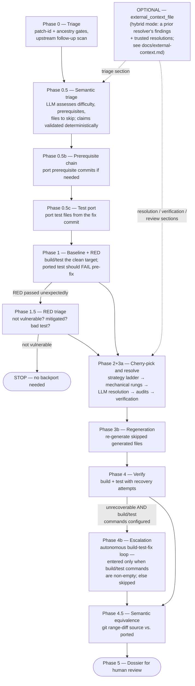

# Auto Bug Fix — git-first backport pipeline

Automatically backports a bug fix commit from one branch to another (e.g. upstream `main` → a release or distribution branch), producing a reviewable commit, a patch file, and a human-readable dossier of everything it did and why.

The design is **git-first**: the pipeline exhausts deterministic, byte-exact mechanisms before letting an LLM touch anything, and every LLM edit is audited against deterministic evidence afterwards.

```
cherry-pick (3-way merge, several strategies)
  └─ conflicts? → mechanical re-apply (git apply, relaxed context)
        └─ still conflicted? → LLM conflict resolution (narrow, per-file)
              └─ always → deterministic audits + verification agent
```

The guiding rule for resolution is three-way discipline: lines the fix changes carry the fix's exact bytes, lines the fix doesn't touch carry the target's exact bytes, and adaptations are only allowed with hard evidence from the target tree (missing symbols, changed signatures, dead config). Human backports overwhelmingly follow this rule; the machinery exists to hold the LLM to it.

---

## How it works



### Phase summary

| Phase | What it does |
|---|---|
| 0 — Triage | Deterministic gates: is the fix already on the target (patch-id, ancestry)? Scans the source branch for upstream follow-up fixes (`Fixes:` tags) to the commit being ported. |
| 0.5 — Semantic triage | An agent assesses difficulty, prerequisite commits, files to skip (e.g. generated files), and regeneration commands. Its prerequisite claims are then validated deterministically against the target tree (0.5.1) and corrected if wrong. |
| 0.5b — Prerequisite chain | Ports prerequisite commits first when the triage found portable ones. |
| 0.5c — Test port | If the fix commit contains test files, ports them before the fix so RED/GREEN checking is possible. |
| 1 — Baseline + RED | Builds and tests the clean target branch to record pre-existing failures. The ported test is expected to FAIL (RED) before the fix is applied. |
| 1.5 — RED triage | If RED unexpectedly passed: decides between *not vulnerable* (pipeline stops — no backport needed), *mitigated* (port anyway for defense-in-depth), or *bad test* (produce a replacement or escalate). |
| 2+3a — Cherry-pick and resolve | `git cherry-pick` with a strategy ladder (default → patience → ort). Conflicted files first go through mechanical rungs (`git apply --ignore-whitespace`, `-C1` of the per-file patch onto the target side — byte-spliced, never regenerated). What remains goes to a narrowly-scoped LLM resolution loop. Finalization then runs the deterministic safety nets (below) and two review agents (3a.1 verification fed with computed evidence, 3a.2 triage-blind review). |
| 3b — Regeneration | Runs the validated regeneration commands for generated files that were deliberately skipped, keeping the result only if the build still passes. |
| 4 — Verify | Build + test. On failure, an agent diagnoses and repairs iteratively (4a); if unrecoverable, escalates to the autonomous build-test-fix loop (4b, `phase_4b.py`) as a last resort — entered only when build and/or test commands are configured (with an empty command set the loop has nothing to run and is skipped, rather than rubber-stamping via marker files). 4b is a single long-running agent using the pipeline profile or an explicit Phase 4b override, fed the full dossier, which writes `run_and_fix_success.txt` or `run_and_fix_failure.txt` to report back. Successful 4a/4b recovery edits are committed as a fixup so they reach the candidate patch and preserved branch. |
| 4.5 — Semantic equivalence | `git range-diff` between the source fix and the backport (squashed into one synthetic commit, so test-port/review/recovery fixups don't skew the comparison), classified into an equivalence verdict. |
| 5 — Dossier | Writes `dossier.md` — every decision, gate value, audit finding, and diff, organized for a human reviewer. |

### Deterministic safety nets (Phase 3a)

Each is individually toggleable under `advanced:` so runs can ablate them.

| Mechanism | Flag | What it does |
|---|---|---|
| Mechanical resolution | `mechanical_resolution` | Re-applies the fix's per-file patch onto the target side with progressively relaxed matching before any LLM sees the conflict. Wins whitespace/context-drift conflicts byte-exactly. |
| Snap-back | `snapback` | After LLM resolution, any line that is whitespace-drifted from a unique source line (fix commit or target pre-image) is snapped back to the source's exact bytes. Skips whitespace-sensitive files (Python, YAML, Makefiles). |
| Evidence checks | `evidence_checks` | Token audit (does every newly-introduced identifier exist on the target?), substitution mining, line-provenance audit (novel/adapted/removed/stale lines, conflict markers), dead-config detection for preprocessor guards, upstream follow-up scan. Findings are rendered into the verification agent's prompt as hard evidence. |
| Post-resolution check | `post_resolution_check` | Phase 3a.1 — a verification agent reviews the resolution against the evidence report and fixes violations of the three-way discipline. |
| Blind review | `blind_review` | Phase 3a.2 — an independent agent reviews the ported diff without seeing the triage, catching anchoring errors. |

---

## Requirements

- Python ≥ 3.14
- git (the pipeline works in a disposable `git worktree` of your repo)
- Python packages: `claude-agent-sdk`, `litellm`, `pyyaml`, `colorama` (from the repo root: `pip install -e .`)
- A reachable model service with tool/function calling support and the credentials it requires. Configure keys in a model profile or use the provider's environment/login setup. Local unauthenticated servers do not require a cloud API key.

---

## Quickstart

Use two files: **`models.yaml`** for reusable model profiles and **`case.yaml`**
for the backport task. `case.yaml` is just an example filename; YAML, YML, and
JSON case files are accepted.

### 1. Create models.yaml

From the repository root, copy the paired templates:

```bash
mkdir -p my-backport
cp auto_bug_fix/configs/example_models.yaml my-backport/models.yaml
cp auto_bug_fix/configs/example_backport.yaml my-backport/case.yaml
```

Edit `my-backport/models.yaml` to describe your models. Profile IDs (`m1`, `m2`,
`m3` here) are names you choose; the `model` inside each profile is the actual
model identifier:

```yaml
models:
  m1:
    provider: anthropic
    model: claude-sonnet-4-6
    # api_key_file: ~/.keys/anthropic.key

  m2:
    provider: litellm
    model: openai/deepseek-r1    # replace with the model name served by your endpoint
    api_base: http://localhost:8080/v1
    # api_key_file: ~/.keys/local-model.key
    params:
      temperature: 0.2
      max_tokens: 16384

  m3:
    provider: anthropic
    model: claude-opus-4-6
    # api_key_file: ~/.keys/anthropic.key

default: m1
```

For `m1`/`m3`, supply an Anthropic key file, set `ANTHROPIC_API_KEY`, or use your
existing Claude SDK login/backend setup. Each profile supplies its own
credentials; `m3` does not inherit `m1`'s key. For `m2`, start your model server
and set its URL and served model name. Supply a key if that server requires one.

### 2. Create case.yaml

Edit `my-backport/case.yaml`, replacing the repository path, refs, commit, and
commands with values for your project:

```yaml
issue_id: "PROJ-1234"
bug_description: "Fix null-pointer dereference in the connection teardown path"

repository:
  source_path: "/path/to/your/repo"       # existing local clone
  workdir: "/tmp/bugfix-workdir"          # disposable worktrees are created here

branches:
  source: "origin/main"                   # branch that has the fix
  target: "origin/release-1.0"            # branch that needs the fix

fix:
  commit: "abc123def456"                  # SHA of the fix on the source branch

build:
  command: "make -j$(nproc)"
  test_command: "make check -j$(nproc)"

model: m1                                # profile ID from models.yaml

# Optional: use another complete profile for Phase 4b recovery.
# advanced:
#   phase_4b_model: m3
```

Use `model: m2` to run with the local server instead. Omitting `model` selects
the registry's `default`. Omit `advanced.phase_4b_model` to use the same profile
throughout the pipeline.

### 3. Run it

```bash
# From the repository root (the directory containing auto_bug_fix/):
python -m auto_bug_fix.run_bug_fix my-backport/case.yaml

# Or select a registry stored elsewhere:
python -m auto_bug_fix.run_bug_fix my-backport/case.yaml --models /path/to/shared-models.yaml

python -m auto_bug_fix.run_bug_fix --help
```

The case path is a required positional argument. The pipeline fetches remote
refs, creates a worktree per target under `repository.workdir`, runs the phases,
and exits 0 only if every target succeeded. CLI artifacts go under
`runs/<case-filename-without-extension>_<timestamp>/` in the working directory.

### 4. Review the result

```
runs/case_20260929_153000/
├── run_log.txt                  # full console log of the whole run
└── release-1.0/                 # one directory per target branch
    ├── run_log.txt              # per-target log
    ├── dossier.md               # ← start here: the human-review dossier
    ├── candidate.patch          # the ported change as a patch file
    ├── semantic_triage.json     # the triage assessment
    └── <issue>_<ts>.json        # machine-readable tracker (gates, phases, outcome)
```

The ported commits are also preserved as a branch in the worktree's repo, named `amalgamator/<issue-id>` (or `amalgamator/<commit>-to-<target>` when `issue_id` is empty), so the result survives worktree cleanup and can be pushed or cherry-picked from directly.

---

## Model registry reference

### Discovery and file paths

The loader uses the first selected registry, without merging files:

1. `--models PATH`, if supplied.
2. A file named exactly `models.yaml` in the case file's directory.
3. `~/.config/amalgamator/models.yaml`.

An explicitly supplied missing, unreadable, or invalid registry causes an error;
the loader does not fall back to another file. `--models` supports `~`, and
relative paths are resolved against the command's working directory. Programmatic
callers can pass the same selection as `models_path=` to either config loader.

Without a registry, bare model names and inline model settings are supported.
If the case also omits `model`, the fallback is `claude-sonnet-4-6`.

### Fields in models.yaml

The top-level `models` mapping must be non-empty. A top-level **`default` is
required** and must name one of its profiles, even when the case explicitly
selects a model.

An optional top-level **`strict: true`** requires registered profile IDs for
explicit `model` and `advanced.phase_4b_model` selections. This catches typos
before any pipeline work starts. The default is `strict: false`, which allows
bare model names with a warning. Strict mode validates IDs, not model/provider
prefixes: any supported model can be used by defining a profile for it.

```yaml
# At the same level as models and default:
strict: true
```

| Profile field | Required | Meaning |
|---|---|---|
| `model` | Yes | Actual model identifier, such as `claude-sonnet-4-6`, `gpt-4o`, `ollama/qwen3:14b`, or `openai/<served-model-name>` |
| `provider` | No | Runner: `anthropic` for Claude Agent SDK, `litellm` for the generic tool-use loop. When omitted, Claude names infer `anthropic`; other names infer `litellm`. An explicit value wins. |
| `api_base` | No | Custom API endpoint, applied per call. For OpenAI-compatible servers, normally include `/v1`. |
| `api_key` | No | Literal API key; takes precedence over `api_key_file`. |
| `api_key_file` | No | File containing the key; contents are read and whitespace-trimmed. Supports `~`; relative paths use the command's working directory, not the registry directory. |
| `params` | No | LiteLLM generation/provider options such as `temperature`, `top_p`, `max_tokens`, or `extra_body`. Also forwarded during context summarization. |

Keep `model`, `provider`, `api_base`, `api_key`, and `api_key_file` at the profile
level: those fields are rejected inside `params`. Request-specific options take
precedence over profile parameters; profile output-token limits take precedence
over the caller's default limit. Nested parameters are copied per request.

Registry values are not environment-variable-interpolated. To use provider
environment credentials, omit the key fields instead of writing
`api_key: "${ANTHROPIC_API_KEY}"`. An unreadable key file produces a warning and
leaves the explicit key unset, allowing the provider's normal credential lookup.

**Additional provider examples:** add entries like these beneath `models`:

```yaml
openai_cloud:
  provider: litellm
  model: gpt-4o
  api_key_file: ~/.keys/openai.key

ollama_local:
  provider: litellm
  model: ollama/qwen3:14b
  api_base: http://localhost:11434
```

Then select `model: openai_cloud` or `model: ollama_local` in the case. Official
OpenAI needs no custom endpoint. Ollama must be running with the chosen model
available. A custom `openai/` endpoint without a profile key uses `OPENAI_API_KEY`
when present, or a dummy key otherwise; set a real key for authenticated servers.

**Claude SDK profiles:** `api_key` and `api_base` become per-client
`ANTHROPIC_API_KEY` and `ANTHROPIC_BASE_URL` overrides. Profiles without explicit
transport preserve SDK login/environment behavior, including a configured
Vertex backend. Explicit direct transport rejects inherited Vertex, Bedrock,
Foundry, or conflicting token-auth modes and disables user/project settings
sources for that client. `params` is a LiteLLM feature, not a mapping of arbitrary
Claude SDK options; use `claude.allowed_tools` and `claude.perm_mode` in the case
for those agent settings.

### Model selection and legacy cases

- `claude.model`, when supplied, takes precedence over top-level `model`.
- A known profile ID selects its complete model, runner, transport, and parameters.
  Inline `api_base`, `api_key`/`api_key_file`, and `model_params` in the case are
  ignored for this selection, with a warning listing field names.
- With `strict: false` (the default), an unregistered string is treated as a
  **bare model name**, with a warning when a registry exists. Enable `strict: true`
  to turn unregistered selections into configuration errors. In strict mode,
  even a Phase 4b override equal to the pipeline's raw model must use its profile ID.
- With no model selection, the registry default wins; only the no-registry path
  falls back to Sonnet.

For older single-file cases, use these fields at the case's top level (alongside
the required repository/fix/build sections):

```yaml
model: openai/deepseek-r1
api_base: http://localhost:8080/v1
api_key_file: ~/.keys/local-model.key
model_params:
  temperature: 0.2
```

The inline parameter key is **`model_params`**, while profiles use **`params`**.
For bare-model cases, top-level endpoint/key settings take precedence over their
legacy `claude` equivalents; discovering an unrelated registry preserves them.

An omitted or unusable `advanced.phase_4b_model` inherits the full pipeline
profile. A known override ID selects that profile; a bare override equal to the
pipeline model inherits the pipeline profile. A different bare override uses
only the case's legacy inline settings, with an inheritance warning when those
fields exist. Use a named override to give Phase 4b its own endpoint and key.

Programmatic callers without profiles retain legacy `common.llm_client.configure()`
transport lookup when changing the Phase 4b model. If the main configuration
carries a profile, supply `BugFixConfig.phase_4b_profile` to select recovery
transport explicitly; a different bare model does not inherit the main profile's
credentials.

## Case YAML reference

### Required

| Key | Meaning |
|---|---|
| `issue_id` | Identifier used in commit messages, branch name, and run artifacts |
| `bug_description` | What the bug is and how the fix addresses it — given to the agents as context |
| `repository.source_path` | Local clone of the repository (read-only; work happens in a worktree) |
| `branches.source` | Ref that has the fix (e.g. `origin/main`); defaults to `origin/main` in patch mode |
| `branches.target` *or* `branches.targets` | Ref(s) that need the fix — exactly one of the two |
| `fix.commit` *or* `fix.patch` | Exactly one: the source fix commit SHA, or a path to a patch file |
| `build` | Section must exist; all keys inside it are optional |

### Optional

| Key | Default | Meaning |
|---|---|---|
| `repository.workdir` | `/tmp/bugfix-workdir` | Where per-target worktrees are created |
| `repository.build_subdir` | *(repo root)* | Subdirectory to run build/test commands in |
| `build.command` | `""` (skip) | Build command |
| `build.test_command` | `""` (skip) | Test command |
| `build.lint_command` | `""` (skip) | Lint command |
| `build.file_check_command` | `""` (skip) | Per-file check run over touched files after resolution, e.g. `"gcc -fsyntax-only {file}"` — `{file}` is replaced with the absolute path |
| `build.auto_discover_tests` | `false` | Let the pipeline discover test commands |
| `model` | Registry default, otherwise `claude-sonnet-4-6` | Profile ID or bare model name for the pipeline, including Phase 4b unless overridden |
| `api_base`, `api_key`, `api_key_file`, `model_params` | Unset | Legacy inline model settings; see the selection rules above |
| `claude.allowed_tools` | `[Read, Write, Bash]` | Tools available to the agents |
| `claude.perm_mode` | `acceptEdits` | Agent permission mode |
| `external_context_file` | Unset | Hybrid mode: path (relative to the case file) to a prior resolver's context Markdown — deterministic scan findings and trusted per-file resolutions, injected as scoped sections into the triage, resolution, verification, and review prompts. Absent = standard pipeline. Produced by [`adapter/`](../adapter/README.md) (`check-backport.py`); see `docs/external-context.md`. |

Repository paths support `~` and environment-variable expansion. Use absolute
repository/workdir paths to make cases independent of the invocation directory;
relative paths use the command's working directory.

### Advanced

```yaml
advanced:
  mechanical_resolution: true    # git-apply rungs before the LLM
  snapback: true                 # snap drifted lines back to source bytes
  evidence_checks: true          # token/provenance audits, dead-config, follow-up scan
  post_resolution_check: true    # Phase 3a.1 verification agent
  blind_review: true             # Phase 3a.2 triage-blind review agent
  timeout_minutes: 0             # per-command timeout; 0/unset = unlimited
  context_length: 128000          # optional token-window override for the LiteLLM runner
  max_build_test_retries: 3      # Phase 4a repair attempts
  max_resolution_retries: 3      # LLM resolution attempts per conflict round
  partial_success_skip_ratio: 0.5  # non-bugfix ports only: dropped-file fraction that downgrades success to partial_success
  phase_4b_model: m3              # optional profile ID (from the quickstart registry)
  forward_patch_id_lookback: "12 months"   # window for the already-applied check
```

Phase 4b uses the pipeline profile by default. Set `phase_4b_model` explicitly
when recovery should use a different model, endpoint, or credential. The selected
model is named in the run log and each tracked query includes its profile ID.

### Context and diff budgets

`advanced.context_length` is a token-window override for the LiteLLM agent and
also controls the full-diff and per-chunk character limits used in prompts:

| Configured context (tokens) | Full-diff cap (characters) | Per-chunk cap (characters) |
|---|---:|---:|
| Unset (128,000 for diff sizing) | 200,000 | 50,000 |
| 262,144 | 200,000 | 50,000 |
| 524,288 | 262,144 | 62,914 |
| 1,048,576 | 524,288 | 125,829 |

The formulas are `max(200000, int(context * 0.125 * 4))` and
`max(50000, int(context * 0.03 * 4))`. The historical floors mean full-diff
scaling takes effect only above approximately **400K tokens**, and per-chunk
scaling above approximately **416.7K tokens**. Conflict-resolution batches also
grow once the per-chunk cap exceeds 50,000 characters.

These limits use the configured value, not the model window auto-detected by
the agent loop. Set `advanced.context_length` explicitly to use larger diff
budgets. The floors preserve historical diff sizes; they are not hard bounds
on the complete prompt's token count.

### Patch input

To supply a patch instead of a source commit, replace the case's `fix` section:

```yaml
fix:
  patch: ./fix.patch
  # upstream_ref: abc123def456  # optional original commit for the follow-up-fix scan
```

`fix.patch` must exist when the case is loaded. Its relative path is resolved
against the **case file's directory**; `~` and environment variables are expanded.
Set exactly one of `fix.commit` and `fix.patch`. The pipeline ingests the patch
into a synthetic source commit before running the normal phases.

### Multiple targets

Backport the same fix to several branches in one run — targets run serially, and one failure does not stop the rest:

```yaml
branches:
  source: "origin/main"
  targets:
    - "origin/release-1.0"
    - "origin/release-1.1"
    - branch: "origin/release-0.9"       # mapping form: per-target overrides
      issue_id: "PROJ-1234-0.9"
      build_command: "make -j$(nproc) LEGACY=1"
```

Per-target override keys: `issue_id`, `bug_description`, `build_command`, `test_command`, `lint_command`.

---

## Outcomes

| Outcome | Meaning |
|---|---|
| `success` (exit 0) | Fix ported, verified, dossier written |
| `partial_success` (exit 1) | Non-bugfix port finished and builds, but dropped a large share of the fix's files or lost prerequisites — see the dossier's "Partial backport" section. Never fires for bug fix commits. |
| `PIPELINE STOP` | A gate decided no backport is needed (fix already present, or target not vulnerable) — this is a *good* outcome, documented in the dossier |
| `PIPELINE ESCALATION` | The pipeline could not finish safely and handed off (Phase 4b) or stopped with a partial, force-resolved state for a human |
| `PIPELINE ERROR` | Unexpected failure; see `run_log.txt` |

The dossier is written in every case that reaches Phase 2; the tracker JSON is written in all cases.

---

## Tests

From the repository root:

```bash
python -m pip install -e '.[test]'
python -m pytest tests/common tests/auto_bug_fix tests/backport_scanner -q
```

The test extra pins `claude-agent-sdk` to the version used by the SDK subprocess
smoke check. That check deliberately inspects private SDK transport internals,
stopping before a CLI process or model API request is started. When updating
the test SDK pin, review and rerun the canary for private-API changes:

```bash
python -m pytest tests/auto_bug_fix/test_sdk_profiles.py -k subprocess_transport_smoke -q
```

The normal runtime dependency continues to accept the supported SDK version range.

---

## What this package shares with the rest of the repository

The model and runner infrastructure is shared through `common/`:

| Import | Why it is shared, not copied |
|---|---|
| `common.claude_utils` | The agent runner, resume handling, message printing and token accounting are identical for every pipeline. `auto_bug_fix/claude_utils.py` is a ~45-line specialization that adds only the backport persona (`BugFixClaudeConfig`) and re-exports the common types. |
| `common.agent_runner` / `common.llm_client` | Provider dispatch, generic tool-use loop, and shared per-call LiteLLM request options |
| `common.model_registry` / `common.model_identity` | Profile loading, safe snapshots, credential resolution, and model classification |
| `common.utils` (`Tee`) | A three-line log tee, byte-identical wherever it was copied. |

Everything else — every phase, prompt, git helper and audit — lives inside the package.

To run it from another checkout, keep `common/` alongside it:

```bash
cp -r auto_bug_fix/ common/ /new/home/
cd /new/home/
pip install 'claude-agent-sdk>=0.2.87' 'litellm>=1.67.0' pyyaml colorama
python -m auto_bug_fix.run_bug_fix path/to/config.yaml
```

Run from the directory *containing* `auto_bug_fix/` — the `-m` invocation needs the package on the path.

Audit the external surface any time with `grep -rnE "^\s*(from|import) (common|auto_code_gen)" auto_bug_fix/*.py` — shared infrastructure comes from `common`, not `auto_code_gen`.

### Module map

| Module | Role |
|---|---|
| `run_bug_fix.py` | Orchestrator: all phases, multi-target loop, entry point |
| `config_loader.py` / `bug_fix_config.py` | YAML/JSON loading, validation, config dataclasses |
| `bug_fix_prompts.py` | All agent prompt templates |
| `claude_utils.py` | Backport persona (`BugFixClaudeConfig`) over the shared runner in `common/claude_utils.py` |
| `phase_4b.py` | Phase 4b autonomous build-test-fix loop prompt |
| `git_tools.py` | git plumbing helpers (ancestry, commits, worktrees, status) |
| `patch_id.py` | Forward/backward patch-id checks (already-applied / predates-bug) |
| `mechanical.py` | Mechanical conflict resolution (`git apply` rungs on conflicted files) |
| `snapback.py` | Whitespace snap-back to source bytes |
| `evidence.py` | Token/line-provenance audits, substitution mining, dead-config detection |
| `baseline.py` | Baseline build/test capture and failure parsing |
| `allowlist.py` | Symbol allowlist derivation for the resolution agents |
| `signature.py` | Function-signature comparison between branches |
| `range_diff.py` | Phase 4.5 semantic-equivalence via `git range-diff` |
| `dossier.py` | Dossier assembly and rendering |
| `tracker.py` | Machine-readable run tracking (phases, gates, outcome) |
| `worktree.py` | Worktree cleanup |
| `configs/` | Example YAML configs |
