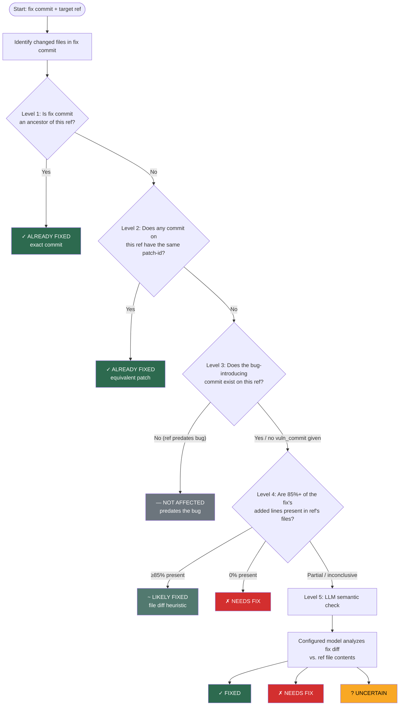

# Backport Scanner

Scans a git repository to determine which **branches, tags, and releases** are missing a given bug fix and need it backported.

Given a fix commit SHA, the scanner checks every target ref — whether it's a release branch (`release-1.33`), a stable release tag (`v6.12.25`), or a versioned distribution branch (`rhel-9.8.z`) — and reports whether the fix is already present, not applicable, or needs to be backported.

Designed to feed directly into the [Amalgamator](../auto_bug_fix/) pipeline — the scanner tells you *where* the fix is needed, and Amalgamator applies it automatically.

### What you can scan

| Ref type | Example | How to configure |
|---|---|---|
| Release branches | `release-1.33`, `release-1.34` | `branch_pattern: "release-1.*"` or `branches: [...]` |
| Stable release tags | `v6.1.120`, `v6.12.25` | `tag_pattern: "v6.*"` or `tags: [...]` |
| Distribution branches | `rhel-9.8.z`, `centos-stream-10/main` | `branches: [...]` |
| Any git ref | Mix of branches and tags | Combine `branch_pattern` + `tag_pattern` in one config |

---

## How it works

### Detection flowchart

For each ref, the scanner runs a 5-level cascade. It stops at the first conclusive result:



### Detection levels

For each ref (branch or tag), a 5-level detection cascade runs in order — the first conclusive result wins:

| Level | Method | What it detects |
|---|---|---|
| 1 | `git_is_ancestor()` | Exact fix commit already reachable from ref |
| 2 | `forward_patch_id_check()` | Same patch content, different SHA (e.g. manual cherry-pick) |
| 3 | `backward_patch_id_check()` | Ref predates the bug — never affected |
| 4 | File diff heuristic | 85%+ of the fix's added lines present in ref's files |
| 5 | LLM semantic check | The configured model resolves remaining `AMBIGUOUS` cases |

**Possible results per ref:**

| Status | Meaning |
|---|---|
| `✓ ALREADY FIXED (exact commit)` | Same SHA is reachable from this ref |
| `✓ ALREADY FIXED (equivalent patch)` | Different SHA but identical patch content |
| `—  NOT AFFECTED` | Ref predates the bug — no fix needed |
| `~  LIKELY FIXED` | Fix lines found via heuristic — verify manually |
| `✗  NEEDS FIX` | Fix is absent — backport needed |
| `?  AMBIGUOUS` | Inconclusive — LLM could not resolve; manual review needed |

---

## Prerequisites

```bash
# Clone the target repository locally (only needed once)
git clone https://github.com/<org>/<repo>.git /path/to/repo

# Install amalgamator dependencies
cd amalgamator/
pip install -e .
```

---

## Quickstart

### Step 1 — Write a scan config

The scanner shares the [model registry](../auto_bug_fix/README.md#model-registry-reference)
with the backport pipeline. Reuse your existing `models.yaml`, or copy the template
beside your scan config and edit the provider/endpoint/credentials:

```bash
cp auto_bug_fix/configs/example_models.yaml models.yaml
```

The examples below select `m1` from that template. Set `llm.model: m2` for its
OpenAI-compatible endpoint, or use another registered ID. A complete scanner
example is available in [`configs/examples/profile_scan.yaml`](configs/examples/profile_scan.yaml).

**Scan branches only:**

```yaml
# scan_branches.yaml
repository:
  local_path: "/path/to/repo"

fix:
  commit: "abc1234"
  description: "fix: short description of the bug fix"

scan:
  branch_pattern: "release-1.*"    # auto-discover matching branches

llm:
  model: m1                       # profile ID from models.yaml
```

**Scan release tags only:**

```yaml
# scan_tags.yaml
repository:
  local_path: "/path/to/linux"

fix:
  commit: "8a8a9fac9efa"
  description: "fix(net/core): CVE-2026-43208"

scan:
  tag_pattern: "v6.*"              # auto-discover matching tags

llm:
  model: m1
```

**Scan both branches and tags together:**

```yaml
# scan_all.yaml
repository:
  local_path: "/path/to/repo"

fix:
  commit: "abc1234"
  description: "fix: short description of the bug fix"
  # vuln_commit: "def5678"         # optional: refs predating this are marked NOT_AFFECTED

scan:
  branch_pattern: "release-1.*"    # branches matching this glob
  tag_pattern: "v1.*"              # tags matching this glob
  # OR list explicitly:
  # branches: ["release-1.33", "release-1.34"]
  # tags: ["v1.33.13", "v1.34.9"]

llm:
  model: m1
  discover_commands: false          # set true to auto-discover build/test commands
```

> You can scan **branches only**, **tags only**, or **both** in a single config. The scanner runs the same 5-level cascade on each ref.

#### Model selection

- Discovery uses `--models PATH` first, then `models.yaml` beside the scan config,
  then `~/.config/amalgamator/models.yaml`. Explicit missing/invalid files fail
  before scanning. `--models` supports `~`; relative paths use the working directory.
- Omitting `llm.model` selects the registry default. Without a registry, the
  scanner's historical default is `claude-opus-4-6`.
- `strict: true` in the registry rejects unregistered `llm.model` selections.
  Permissive registries allow bare model names with a warning. Bare-model scanner
  calls retain their legacy environment/global transport lookup.
- Named profiles supply model, endpoint, credentials, and `params` per call.
  Loading a scan config does not seed application-wide transport globals.
- Semantic checks and optional build/test command discovery use one-shot
  LiteLLM completions. The profile's `provider` runner selection is used when
  the generated case later runs through the backport pipeline's agent steps.

Claude scanner calls need credentials usable by LiteLLM, such as an Anthropic
API key or a configured Vertex route. Claude SDK login is used by the SDK agent
path, not by these one-shot scanner calls.

For authenticated OpenAI-compatible endpoints, put `api_base`, an `openai/`-prefixed
model name, and `api_key_file` in the profile. The key file contains the raw token;
LiteLLM sends it as a Bearer token. See the
[profile field reference](../auto_bug_fix/README.md#fields-in-modelsyaml) for details.

### Step 2 — Run the scanner

```bash
# From the amalgamator/ root directory:
python -m backport_scanner.run_scanner --config my_scan.yaml

# Save a JSON report:
python -m backport_scanner.run_scanner --config my_scan.yaml --output report.json

# Verbose logging:
python -m backport_scanner.run_scanner --config my_scan.yaml --verbose

# Select a shared registry explicitly:
python -m backport_scanner.run_scanner --config my_scan.yaml --models /path/to/models.yaml
```

### Step 3 — Generate Amalgamator configs and run the pipeline

See the [Auto-generate Amalgamator YAML](#auto-generate-amalgamator-yaml-generate_configpy) section below for `generate`, `add`, and `verify` modes.

---

## Example output

```
======================================================================
  BACKPORT SCANNER REPORT
======================================================================
  Repo:        /path/to/repo
  Fix commit:  abc1234
  Description: fix: short description of the bug fix
  Refs scanned: 4 branch(es) + 3 tag(s)
======================================================================

  REF                STATUS
  -----------------  ----------------------------------------
  release-1.30       ✗  NEEDS FIX
                     → Fix lines not found in origin/release-1.30 files
  release-1.31       ✗  NEEDS FIX
                     → Fix lines not found in origin/release-1.31 files
  release-1.37       ✓  ALREADY FIXED (exact commit)
                     → Commit abc1234 is reachable from origin/release-1.37
  release-1.0        —  NOT AFFECTED  (predates the bug)
  [tag] v6.1.120     ✗  NEEDS FIX
                     → Fix lines not found in v6.1.120 files
  [tag] v6.6.87      ✓  ALREADY FIXED (exact commit)
                     → Commit abc1234 is reachable from v6.6.87
  [tag] v6.12.25     ✓  ALREADY FIXED (equivalent patch)

----------------------------------------------------------------------
  NEEDS FIX    : 3 ref(s)
  ALREADY FIXED: 3 ref(s)
  NOT AFFECTED : 1 ref(s) — predates the bug
======================================================================
```

---

## Auto-generate Amalgamator YAML (`generate_config.py`)

Three modes to bridge scanner output → `auto_bug_fix` pipeline configs:

**`generate` — create YAMLs from scratch**

```bash
python -m backport_scanner.generate_config \
  --config my_scan.yaml \
  --mode generate \
  --output-dir ./generated/
```

All three generator modes accept `--models PATH`, with the same discovery and
strict-selection rules as the scanner.

Generated cases retain the selected profile ID (including a registry default)
or bare model name. Each file includes a runnable command in its header and the
generator prints that command, using the selected registry's absolute path:

```bash
python -m auto_bug_fix.run_bug_fix /path/to/generated/case.yaml --models /path/to/models.yaml
```

Use the same working directory as generation so relative repository/key-file
paths keep their meaning. Profile credentials and parameters are read from the
original registry rather than copied into generated YAML. `add` and `verify`
keep the existing case's model selection. Programmatic callers generating cases
from a `ScanConfig.profile` must also supply its registry as `ScanConfig.models_path`.

**Auto-discovering build and test commands**

By default, `build.command` and `build.test_command` are left empty for you to fill in. Enable `discover_commands` to have the LLM read the repo's `README`, `Makefile`, CI workflows, and build files to suggest the right commands:

```yaml
llm:
  # LLM is always used for ambiguous cases (Level 5)
  model: m1
  discover_commands: true   # LLM fills in build/test commands
```

The LLM reads: `README.md`, `Makefile`, `go.mod`, `pom.xml`, `pyproject.toml`, `setup.py`, `.github/workflows/*.yml`

Command discovery uses the same resolved profile, including credentials and
generation parameters, as the semantic scan.

> Always review discovered commands before running the pipeline.

**`add` — append newly-found branches to an existing YAML**

```bash
python -m backport_scanner.generate_config \
  --config my_scan.yaml \
  --mode add \
  --existing-yaml ./configs/my_fix.yaml
```

**`verify` — confirm branches in an existing YAML still need the fix**

```bash
python -m backport_scanner.generate_config \
  --config my_scan.yaml \
  --mode verify \
  --existing-yaml ./configs/my_fix.yaml
```

---

## JSON report structure

```json
{
  "repo": "/path/to/repo",
  "fix_commit": "abc1234",
  "fix_description": "fix: short description",
  "summary": {
    "total": 7,
    "needs_fix": 3,
    "already_fixed": 3,
    "ambiguous": 0,
    "errors": 0
  },
  "refs": [
    {
      "name": "release-1.33",
      "ref_type": "branch",
      "status": "NEEDS_FIX",
      "method": "file diff heuristic",
      "detail": "Fix lines not found in origin/release-1.33 files",
      "changed_files": ["path/to/changed_file.go"]
    },
    {
      "name": "v6.1.120",
      "ref_type": "tag",
      "status": "NEEDS_FIX",
      "method": "file diff heuristic",
      "detail": "Fix lines not found in v6.1.120 files",
      "changed_files": ["path/to/changed_file.go"]
    },
    {
      "name": "release-1.37",
      "ref_type": "branch",
      "status": "ALREADY_FIXED",
      "method": "git_is_ancestor",
      "detail": "Commit abc1234 is reachable from origin/release-1.37",
      "changed_files": ["path/to/changed_file.go"]
    }
  ]
}
```

---

## Example configs

| Config | What it scans | Ref types |
|---|---|---|
| [`openssl_scan.yaml`](configs/examples/openssl_scan.yaml) | OpenSSL release branches | Branches |
| [`kubernetes_scan.yaml`](configs/examples/kubernetes_scan.yaml) | Kubernetes release branches | Branches |
| [`profile_scan.yaml`](configs/examples/profile_scan.yaml) | A selected model profile with optional command discovery | Branches |
