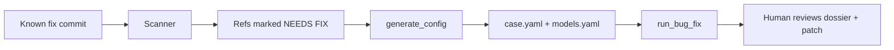

# Bug-fix backporting — overview

Two packages work together:

| Package | Job |
|---------|-----|
| [backport_scanner](scanning.md) | For a fix SHA, report which branches/tags/releases already have it, are unaffected, or still need it |
| [auto_bug_fix](backporting.md) | Port the fix onto a target branch with a git-first, evidence-audited pipeline |

Typical flow:

You can skip the scanner when you already know the target ref.

## Shared model registry

Both tools use the same `models.yaml` discovery rules. Set this up once:
[Authentication](../authentication.md).

## Design in one sentence

Prefer `git cherry-pick` and mechanical re-apply; only then allow a narrowly
scoped LLM; always verify with your build/test commands; always leave a
human-readable dossier.

Deep dives:

- [auto_bug_fix/README.md](../../auto_bug_fix/README.md)
- [backport_scanner/README.md](../../backport_scanner/README.md)
