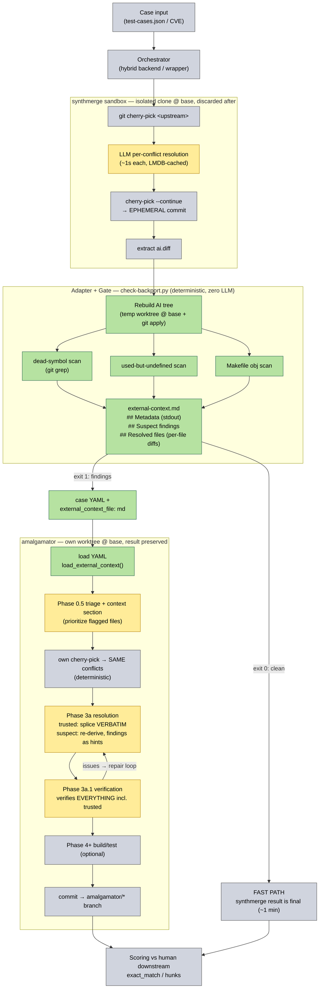

# External Resolver Context (hybrid synthmerge → amalgamator pipeline)

## Motivation

Fast per-conflict resolvers (synthmerge) complete cherry-picks in seconds
but fail exact-match on hard backports with a small number of residual
defects. A Frankenbench case study (8 hard cases, 27 residual hunks) showed
the defects cluster into a taxonomy where roughly half are mechanically
detectable (dead symbols, used-but-undefined symbols, Makefile objects)
while the rest need semantic verification or agentic repair.

The hybrid design: let the fast resolver do the bulk of the work, run
deterministic checks (git grep based, no LLM, no build) over its result,
and escalate to the full amalgamator pipeline **only** when the checks
fail — handing amalgamator both the prior resolver's output and the
check findings so it does not start from zero.

## The mechanism

A new optional top-level key in the case YAML:

```yaml
external_context_file: tc896-external-context.md   # relative to the config file
```

The referenced Markdown file carries everything the prior stage knows
(see `auto_bug_fix/external_context.py` for the parser and the format
spec, and `docs/external-context-template.md` for a fill-in template).

Loading is fail-safe in one direction only:

- key absent → feature off, pipeline identical to before;
- file missing or non-string path → `ConfigError` at load time (the user
  explicitly asked for context; a typo must not silently disable it);
- file present but empty or partially malformed → feature degrades to
  whatever sections parsed; parse issues are logged, never raised.

## Prompt injection (the "strategy pattern")

`ExternalContext` is a strategy object with one renderer per phase. An
inactive context renders `""` everywhere, so neither the prompts nor the
pipeline call sites branch on it — they just pass the rendered section
through, exactly like the existing `triage_section` / `evidence_section`
conditional sections:

| Phase | Renderer | What the agent is told |
|---|---|---|
| 0.5 semantic triage | `render_triage_section()` | a prior resolver exists; its cleared files are low-risk, its flagged files deserve priority |
| 3a narrow resolution | `render_resolution_section()` | reproduce trusted prior resolutions **verbatim** (splice, never retype); re-derive only suspect regions from the fix diff, using the finding as a hint; the prior resolver's keep/drop decisions are not authoritative — the three-way discipline wins |
| 3a.1 verification | `render_verification_section()` | findings are injected as evidence; **verification scope is never reduced** — every hunk is verified, including trusted ones |

The trusted/suspect split is derived from the deterministic checks, not
from the prior resolver's self-assessment: a file is "trusted" only
because the scans found nothing wrong with it, and it still goes through
full verification later.

## What this deliberately does NOT do (yet)

- **Mechanical pre-application**: the resolution agent reproduces trusted
  resolutions via the prompt rather than the pipeline writing them to
  disk and `git add`-ing them mechanically (the way
  `mechanical_resolution` / `files_to_skip` remove files from `uu_files`).
  The `## Resolved files` section already carries per-file content in a
  machine-usable form, so this is a straightforward follow-up once the
  prompt-level version is validated.
- **Pre-resolved entry mode**: the pipeline still performs its own
  cherry-pick; the prior resolutions are context, not state. Since the
  cherry-pick is deterministic (same base + same upstream commit → same
  conflicts), the prior resolutions remain directly reusable.
- **The checker itself** lives outside amalgamator (harness/wrapper side):
  it produces the findings and this Markdown file. See
  `synthmerge-internal/benchmarks/docker/synthmerge-verify-poc.sh` for the
  scan prototype (dead-symbol, undefined-symbol, Makefile-obj checks).

## Example end-to-end flow



Invariants the diagram encodes:

- **Only text crosses** between the two worlds: the external-context MD is
  the sole channel; no git objects are shared (synthmerge's commit is
  ephemeral, amalgamator re-creates the identical conflict state because a
  cherry-pick is deterministic).
- **The adapter is also the gate**: exit 0 means the fast path ships without
  ever paying amalgamator's cost; exit 1 escalates with findings in hand.
- **Trust is prompt-level in v1**: "splice verbatim" is an instruction to the
  resolution agent, not a mechanical checkout; Phase 3a.1 still verifies
  everything, so a wrong trusted resolution can be caught, not just shipped.

## Files

- `auto_bug_fix/external_context.py` — parser + strategy renderers + tests
- `auto_bug_fix/bug_fix_config.py` — `external_context_file` / `external_context` fields
- `auto_bug_fix/config_loader.py` — YAML key parsing, path resolution, validation
- `auto_bug_fix/bug_fix_prompts.py` — `external_context_section` on the three prompts
- `auto_bug_fix/run_bug_fix.py` — one-time load in `run_pipeline`, section wiring
- `docs/external-context-template.md` — fill-in template for the Markdown file
