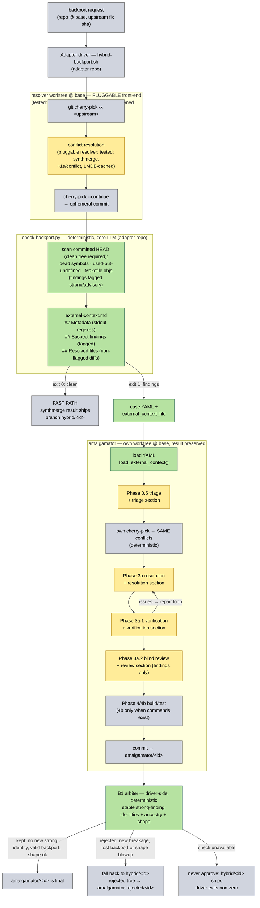

# External Resolver Context (hybrid synthmerge → amalgamator pipeline)

## Motivation

The prior resolver is a **pluggable front-end**: anything that finishes a
cherry-pick and leaves a commit on top of a known base — plain git on a
clean pick, a human, a mechanical applier, or an LLM conflict resolver.
Fast per-conflict resolvers complete cherry-picks in seconds
but fail exact-match on hard backports with a small number of residual
defects. A hard-case study (the 8 hardest cases, 27 residual hunks) showed
the defects cluster into a taxonomy where roughly half are mechanically
detectable (dead symbols, used-but-undefined symbols, Makefile objects)
while the rest need semantic verification or agentic repair.

The hybrid design: let the fast resolver do the bulk of the work, run
deterministic checks (git grep based, no LLM, no build) over its result,
and escalate to the full amalgamator pipeline **only** when the checks
fail — handing amalgamator both the prior resolver's output and the
check findings so it does not start from zero. The resolver this design
was built and validated with is
[synthmerge](https://gitlab.com/aarcange/synthmerge) (all numbers below);
the adapter's gate, escalation and arbiter are resolver-agnostic.

Validated at scale: on a 400-case kernel-backport evaluation with the
same model at every stage, the hybrid scored 42.5% combined
exact/whitespace-stripped matches against known human results vs 35.5%
for the fast resolver alone — the escalation converted 37 misses into
matches at 7 degradations (see the adapter repo's README for the full
numbers and the deterministic arbiter that bounds the damage).

## The mechanism

A new optional top-level key in the case YAML:

```yaml
external_context_file: tc896-external-context.md   # relative to the config file
```

The referenced Markdown file carries everything the prior stage knows
(see `auto_bug_fix/external_context.py` for the parser and the format
spec, and `docs/external-context-template.md` for a fill-in template).

Loading is fail-safe in one direction only:

- key absent → feature off, pipeline identical to before;
- file missing or non-string path → `ConfigError` at load time (the user
  explicitly asked for context; a typo must not silently disable it);
- file present but empty or partially malformed → feature degrades to
  whatever sections parsed; parse issues are logged, never raised.

## The Markdown contract (what the emitter must know)

Only three sections are machine-parsed — `## Metadata` (key: value
bullets), `## Suspect findings` (one bullet per finding, `path:line:
reason` preferred), `## Resolved files` (`### <path>` headers each
followed by a fenced diff block). Everything else is passed through
verbatim.

Rules that bit us, now part of the contract:

- **No placeholder bullets.** A clean run emits *no* bullet under
  `## Suspect findings` — a `- (none)` placeholder would parse as a
  phantom finding and mislead every downstream phase.
- **Findings are copied verbatim, with their tags.** The emitter prefixes
  every bullet with `[severity][class][evidence/confidence]` and never
  paraphrases or softens the text. The tags are the contract:
  `strong` marks objective breakage classes, `advisory` marks correlation
  signals, `observed` marks a fact in the tree, `inferred` marks a
  heuristic conclusion. Untagged (human-written) bullets parse as
  advisory/inferred. The reviewer and resolution prompts are told these
  are automated heuristics to verify — deterministic means repeatable,
  not necessarily correct — so a split-line definition, Kbuild composite,
  or macro-generated reference cannot become an unquestionable order.
- **Findings may carry upstream-tree observations.** The emitter has
  access to the upstream fix's tree and appends facts like "the upstream
  tree defines it in: … — port that definition" or "upstream only shows
  it in … — a declaration alone does not prove the call resolves", plus
  advisory discipline notes like "these symbols predate the patch — do not
  remove or replace them on this check's account". A header's own
  declaration is never counted as an upstream reference. Agents treat
  these as evidence to check, not as instructions to obey blindly.
- **Flagged files are excluded from `## Resolved files`.** Their prior
  content is noise for re-derivation; non-flagged files are the trusted
  set.
- **Metadata is regexed from the prior resolver's captured stdout**
  (conflict count, relocation retries, extra-conflict-lines escalation,
  duration, endpoint label). It is provenance for orientation, never
  evidence. The resolver front-end is pluggable; unrecognized or absent
  stdout degrades every field to `unknown` rather than claiming a tool —
  `resolver: synthmerge` appears only when synthmerge's log is recognized
  (tested resolver: [synthmerge](https://gitlab.com/aarcange/synthmerge)).

## Trust boundary

The external-context file is prompt content by design, exactly like the case
YAML: anyone who can write it can influence the agents' instructions,
including the wording under `## Suspect findings` and the "splice verbatim"
mandate for trusted resolutions. The loader validates existence, not content,
which is the correct scope for an operator-provided file.

The mitigations are behavioral rather than content sanitization: the
three-way discipline and the fix diff override the prior resolver; Phase
3a.1 verification scope is never reduced; the blind reviewer receives
findings only; advisory findings are framed as heuristics; and the file path
is resolved relative to the case file. Do not accept context files from
untrusted sources.

## Prompt injection (the "strategy pattern")

`ExternalContext` is a strategy object with one renderer per phase. An
inactive context renders `""` everywhere, so neither the prompts nor the
pipeline call sites branch on it — they just pass the rendered section
through, exactly like the existing `triage_section` / `evidence_section`
conditional sections:

| Phase | Renderer | What the agent is told |
|---|---|---|
| 0.5 semantic triage | `render_triage_section()` | a prior resolver exists; its cleared files are low-risk, its flagged files deserve priority |
| 3a narrow resolution | `render_resolution_section()` | reproduce trusted prior resolutions **verbatim** (splice, never retype) — the exact saved patch bytes for the files in the current request are embedded in the prompt; re-derive only suspect regions from the fix diff, verifying each finding first (it may be a false positive); the prior resolver's keep/drop decisions are not authoritative — the three-way discipline wins |
| 3a.1 verification | `render_verification_section()` | findings are injected as evidence; **verification scope is never reduced** — every hunk is verified, including trusted ones |
| 3a.2 blind review | `render_review_section()` | **findings + metadata only — the trusted resolutions are deliberately withheld** so the reviewer stays independent of the resolution agent's choices. Two mandates: (1) do not reintroduce a symbol flagged as dead/undefined unless the finding is demonstrably a false positive; (2) a wholesale revert of the port is out of mandate — report, don't revert |

The trusted/suspect split is derived from the deterministic checks, not
from the prior resolver's self-assessment: a file is "trusted" only
because the scans found nothing wrong with it, and it still goes through
full verification later.

The 3a.2 row is hard-won: in the first hybrid run the blind reviewer —
then the only unseeded agent — followed the base-prompt rule *"if a
symbol exists on the baseline but was removed from the port, restore
it"* into reverting a byte-exact correct resolution (the upstream fix
itself removed the `dop_inodes[]` infrastructure; baseline existence is
not evidence the port should keep it). Two fixes landed together: the
restoration rule in the base review prompt is now **upstream-conditioned**
(restore only symbols the fix still uses or adds; symbols the fix itself
removes stay removed), and 3a.2 receives the scoped findings-only section
above.

## Related hardenings on this branch

Two amalgamator-side changes made during hybrid validation, both
interacting with external-context runs:

- **4b-entry guard**: the run-and-fix phase is entered only when build
  and/or test commands are non-empty. With an empty command set, vacuous
  4b entries rubber-stamped poisoned trees via marker-file failures; in
  the 400-case validation it blocked all 44 would-be vacuous entries.
  A force-resolved tree (resolution failed, conflicts overwritten with
  `--theirs`) that never gets an independent build/test verification now
  ends as **`unverified`**, never `success`.
- **XML tool-call fallback**: the litellm loop can recover Claude-style
  XML tool calls from content when the endpoint returns malformed JSON
  tool calls. It is an explicit provider compatibility mode
  (`claude.xml_tool_fallback: true` in the case YAML) and is off by
  default. When enabled, only a message whose entire content is XML tool
  blocks is executed; prose and fenced examples stay text.

## What this deliberately does NOT do (yet)

- **Mechanical pre-application**: the resolution agent receives the exact
  saved patch bytes embedded in the prompt, but the pipeline does not
  write them to disk and `git add` them mechanically (the way
  `mechanical_resolution` / `files_to_skip` remove files from `uu_files`).
  The `## Resolved files` section already carries per-file content in a
  machine-usable form, so this remains a straightforward follow-up.
- **Pre-resolved entry mode**: the pipeline still performs its own
  cherry-pick; the prior resolutions are context, not state. Since the
  cherry-pick is deterministic (same base + same upstream commit → same
  conflicts), the prior resolutions remain directly reusable.
- **The checker and the driver live in this repo's
  [`adapter/`](../adapter/README.md) subdirectory:
  `check-backport.py` requires a clean committed snapshot, scans `HEAD`
  (with base and upstream treeishes supplying comparison) and emits this
  Markdown; `hybrid-backport.sh` orchestrates the whole flow and
  `arbiter.py` decides the result (below). `strip-artifacts.py` removes
  pipeline bookkeeping from the delivered tree.

## Example end-to-end flow



Invariants the diagram encodes:

- **Only text crosses** between the two worlds: the external-context MD is
  the sole channel; no git objects are shared (synthmerge's commit is
  ephemeral, amalgamator re-creates the identical conflict state because a
  cherry-pick is deterministic).
- **The adapter is also the gate**: exit 0 means the fast path ships without
  ever paying amalgamator's cost; exit 1 escalates with findings in hand.
- **Trust is prompt-level in v1**: "splice verbatim" is an instruction to the
  resolution agent, with the exact prior patch bytes embedded in the
  prompt — not a mechanical checkout. Phase 3a.1 still verifies
  everything, so a wrong trusted resolution can be caught, not just shipped.
- **The escalation must prove itself**: after amalgamator commits, the
  driver re-runs the same deterministic scans on the result and compares
  *stable strong-finding identities*, validates that the candidate is a
  meaningful descendant of base touching the upstream fix, and applies a
  diff-shape rule. A new strong identity, lost backport, or
  wholesale-replacement blowup is rejected and the pre-gate tree ships.
  If the post-check or arbiter cannot run, the candidate is not approved
  and the driver exits non-zero. In the 400-case validation: 20 kept /
  4 rejected, every rejection an unambiguous blowup.

## Validation summary

- **Scale**: 400 kernel-backport cases, same model at every stage —
  fast resolver alone 35.5% → hybrid 42.5% combined match vs human
  results; on the 158 escalations: 37 fixed / 114 unchanged / 7 worse;
  arbiter 20 kept / 4 rejected.
- **Real-world single-commit runs** (no harness): representative rescue —
  synthmerge restored ACPI HEST macros but never wired up their uses (2
  hunks off the human result); five "introduced but zero references"
  findings escalated; the seeded amalgamator repaired it with a 2-line
  change → byte-exact vs the human maintainer in 12.8 minutes.

## Files

- `auto_bug_fix/external_context.py` — parser + strategy renderers (incl.
  `render_review_section`) + tests
- `auto_bug_fix/bug_fix_config.py` — `external_context_file` / `external_context` fields
- `auto_bug_fix/config_loader.py` — YAML key parsing, path resolution, validation
- `auto_bug_fix/bug_fix_prompts.py` — `external_context_section` on the four prompts;
  the upstream-conditioned restoration rule in the review prompt
- `auto_bug_fix/run_bug_fix.py` — one-time load in `run_pipeline`, section wiring
- `docs/external-context-template.md` — fill-in template for the Markdown file
- `adapter/` — the hybrid adapter (`check-backport.py` emitter,
  `arbiter.py` post-escalation verdict, `strip-artifacts.py` tree cleanup,
  `hybrid-backport.sh` driver)
