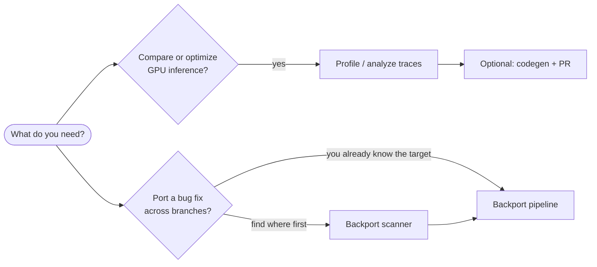

# Getting started

Amalgamator is a set of Python pipelines you run from a local clone. There is no
hosted service: you supply git repositories, (for GPU work) traces or GPU
machines, and credentials for the LLM provider you choose.

## Prerequisites

| Requirement | Notes |
|-------------|-------|
| **OS** | Linux or macOS. Windows is not supported. |
| **Python** | 3.12 or newer. CI tests 3.12 and 3.14. |
| **uv** | Recommended for install and locked deps ([Astral uv](https://docs.astral.sh/uv/)). Plain `pip` also works — see [CONTRIBUTING.md](../CONTRIBUTING.md#development-setup). |
| **git** | Required for every pipeline. |
| **LLM access** | Backporting: Claude, OpenAI, Ollama, or any OpenAI-compatible server. GPU analysis/codegen: Claude (Agent SDK). Details in [Authentication](authentication.md). |

Optional, depending on workflow:

| Extra | Needed for |
|-------|------------|
| GPU machine + framework sources | Profiling and runtime validation of ported optimizations |
| Trace files (`.nsys-rep`, `.sqlite`, `.json`, `.json.gz`) | Trace analysis without re-profiling |
| `nsys` (Nsight Systems) | Converting `.nsys-rep` traces |
| GitHub CLI (`gh`) | Human-driven PR publish steps in the codegen PR flow |
| `git-lfs` | Committing large traces into *this* repo (`*.nsys-rep`, `*.json.gz`); not required to clone Amalgamator |

## Install

```bash
git clone https://github.com/amalgamator-ai/amalgamator.git
cd amalgamator
uv sync
```

For development (tests and lint tools):

```bash
uv sync --extra test --extra dev --locked --python 3.12
```

Run modules from the repository root with either an activated environment or
`uv run`:

```bash
uv run python -m auto_bug_fix.run_bug_fix --help
# or, after activating .venv:
python -m auto_bug_fix.run_bug_fix --help
```

## Choose a path



| Goal | Start with |
|------|------------|
| Annotate one GPU trace in Perfetto | [Trace analysis](gpu/analysis.md) |
| Profile frameworks, then analyze | [Profiling](gpu/profiling.md) → analysis |
| Port a performance optimization | Analysis → [Code generation](gpu/codegen.md) |
| Discover which releases lack a fix | [Scanner](backporting/scanning.md) |
| Backport a known fix commit | [Backport pipeline](backporting/backporting.md) |

## Minimal examples

### Analyze an existing GPU trace

```bash
uv run python -m llm.auto_analyze.run_single_trace --config /path/to/config.json
```

Create the config with `create_single_trace_config`, or follow the
[single-trace guide](../llm/auto_analyze/examples/single_trace_analysis_and_annotation_guide.md).

### Backport a fix

```bash
mkdir -p my-backport
cp auto_bug_fix/configs/example_models.yaml my-backport/models.yaml
cp auto_bug_fix/configs/example_backport.yaml my-backport/case.yaml
# Edit both files for your provider, repo, fix SHA, and build/test commands.
uv run python -m auto_bug_fix.run_bug_fix my-backport/case.yaml
```

Review `runs/<case>_<timestamp>/` — start with each target's `dossier.md` and
`candidate.patch`.

### Scan for missing backports

```bash
cp auto_bug_fix/configs/example_models.yaml models.yaml
# Write a scan YAML (see backporting/scanning.md), then:
uv run python -m backport_scanner.run_scanner --config my_scan.yaml
```

## Next steps

- Read [Concepts](concepts.md) for design rules that affect how you configure runs.
- Set up credentials in [Authentication](authentication.md).
- Use the [CLI reference](reference/cli.md) when assembling a longer pipeline.
- Package READMEs under each directory remain the source of truth for field-level
  config; this `docs/` tree is the user-oriented map.
